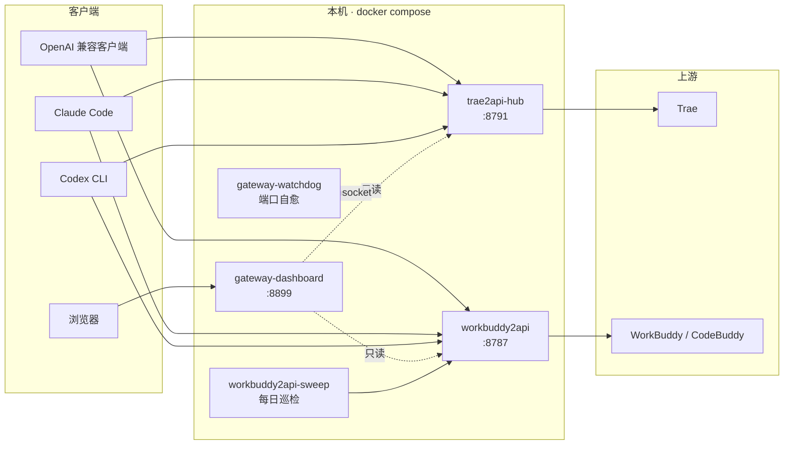

# AI Gateways

把两家的 AI 订阅额度统一暴露成 **OpenAI / Anthropic / Responses 三协议兼容**的
本地 API，外加一个**统一的用量面板**。

一套 `docker compose` 全起：Trae 网关 + WorkBuddy 网关 + 用量面板 + 端口看门狗。



## 三个组件

| 组件 | 端口 | 说明 |
|---|---|---|
| **Trae 网关** | 8791 | 把 Trae 订阅额度转成 API。修了大模型工具调用、真流式、token 计量等问题 → [`docs/trae.md`](docs/trae.md) |
| **WorkBuddy 网关** | 8787 | 把 WorkBuddy / CodeBuddy 订阅额度转成 API。解决了 11128 渠道校验 → [`docs/workbuddy.md`](docs/workbuddy.md) |
| **用量面板** | 8899 | 一个页面看两边的积分、签到、请求来源、各来源消耗 → [`docs/dashboard.md`](docs/dashboard.md) |

另外两个旁挂服务（可选）：

- `workbuddy2api-sweep` — 每天 00:05 给每个账号发一条最小请求 + 补签到
- `gateway-watchdog` — 每 30s 检查端口绑定/容器存活，出问题自动重建 → [`docs/operations.md`](docs/operations.md)

## 快速开始

```bash
# 1. 构建三个镜像（拉上游 → 打补丁 → build）
./scripts/build.sh

# 2. 配置
cp .env.example .env
$EDITOR .env        # 填三个 key + PROJECT_DIR + 绑定地址

# 3. 启动
docker compose up -d
```

然后拉起账号：

```bash
# WorkBuddy：把桌面客户端的 accounts.json 放到 data/workbuddy/workbuddy2api/
# Trae：导入 refreshToken 或桌面客户端凭证（见 docs/trae.md）
```

## 为什么不做成「一个网关」

两个上游是**两个不同作者的独立项目**，架构完全不同（Trae 是
`ThreadingHTTPServer` + 纯标准库零依赖；WorkBuddy 是 FastAPI + 十来个模块）。
硬合并要写适配层，纯亏。

所以本项目的做法是：**不 vendor 上游源码，只维护一层补丁**。

```
本仓库拥有         上游拥有
─────────────     ──────────────────
patches/*.patch → 上游源码（按固定基线提交拉取）
docker/*.Dockerfile
docker-compose.yml
dashboard/app.py
scripts/build.sh
docs/
```

好处：上游更新时不需要 rebase 整个 fork，只要重新生成补丁；补丁冲突会由
`build.sh` 的 `git apply --check` 明确报出来，不会打出一个半截补丁。

## 目录

```
.
├── docker-compose.yml          一套 compose 起全部服务
├── .env.example                配置模板
├── scripts/
│   ├── build.sh                拉上游 + 打补丁 + 构建三个镜像
│   └── daily_sweep.py          每日巡检（旁挂，通过网关公开接口工作）
├── patches/
│   ├── trae2api-hub.patch      只改 trae_proxy.py
│   ├── workbuddy2api.patch     只改 converter.py
│   └── channel_guard.py        新增文件（11128 渠道校验对抗）
├── dashboard/
│   └── app.py                  用量面板（单文件 FastAPI，HTML 内联）
├── docker/
│   ├── workbuddy.Dockerfile
│   ├── dashboard.Dockerfile
│   └── wheels/                 离线依赖（构建机常连不上 PyPI）
└── docs/
    ├── trae.md                 Trae 专有：模型通道、4017 风控、账号池
    ├── workbuddy.md            WorkBuddy 专有：11128 两道门、区域分区
    ├── dashboard.md            面板：数据来源、失败统计口径
    └── operations.md           运维：重启后自愈、备份、补丁冲突
```

## 安全

- `.env` 与 `data/` 都在 `.gitignore` 里 —— **账号凭据绝不进仓库**。
- 网关默认只绑 `127.0.0.1`，必须在 `.env` 里显式填 `LAN_IP` / `TAILNET_IP` 才对外发布。
- 面板**没有鉴权**，建议只绑 tailnet：
  ```bash
  TAILNET_IP=100.x.y.z    # `tailscale ip -4`
  LAN_IP=127.0.0.1        # 内网不暴露
  ```

## 免责声明

见 [DISCLAIMER.md](DISCLAIMER.md)。**请先读再部署。**

## 第三方

上游均为 MIT，完整许可见 [THIRD_PARTY_NOTICES.md](THIRD_PARTY_NOTICES.md)。

## 许可

MIT，见 [LICENSE](LICENSE)。本项目自身的代码如此授权；上游代码各自遵循其原许可。
